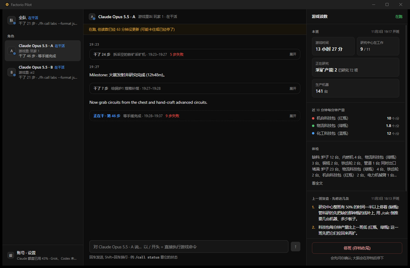
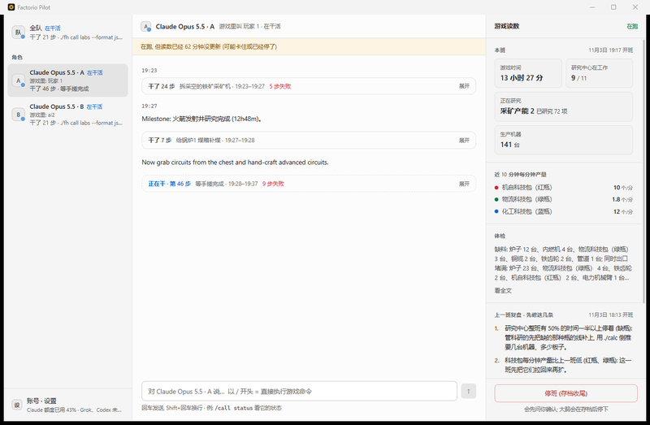

# Factorio Pilot 桌面界面 (Tauri)

看大脑在干什么、对它说话、直接执行游戏命令的 Windows 桌面程序。三栏布局照 x.ai/bot, 样式改自 OpenGrokBot (MIT, 见仓库 NOTICE)。

| 深色 | 亮色 |
|---|---|
|  |  |

- **聊天室样式**: 头像是模型厂商的 LOGO (白底圆形; Claude、OpenAI、Grok、DeepSeek、智谱, 来自 LobeHub 图标库 `@lobehub/icons-static-svg`, MIT, 见 NOTICE; 认不出厂商时写字母), 大脑说的靠左、你说的靠右蓝气泡 (头像"我"); 同一个人连着说的只有第一句放头像和名字, 停 3 分钟以上再放。全队里名字旁边有"游戏里: MK"小标签。
- **按世界分对话**: 一个世界 = 同一张图连续跑的几班 (接着上一班的存档跑就是同一个世界; 以后每个联机服务器各算一个), 实跑开班时写进 `<班次目录>/world.json` (`src/play/worlds.ts`); 11-03 以前没记的班次归"旧记录"。左上角写着现在看的世界和班次, 点开列出各世界的班次 (在跑 / 收尾了 / 中断了), 点一班看它的对话和复盘 (复盘只在同一个世界里往前找)。
  - **打开时没有在跑的班 = 干净的空对话**: 中间是空的, 顶上一行"没有在跑 · 上一班 (…) 的记录 → 查看"; 开了新的一班会自己跳过去 (正在空对话或在看刚收尾的那班时; 自己选了更早的班不动)。
  - **收起只放标记不删**: 每班旁边"收起"只在班次目录放一个 `hidden` 文件 (记录都留着, 复盘、下一班的"先修这几条"、接着跑都要用), "显示收起的"能放回来; "清我的话"清掉你在那一班发过的话和命令 (这些只存在界面里)。
- **窗口不再先白一下**: 窗口建的时候是隐藏的, 页面画好再显示 (万一页面没起来, 外壳 4 秒后也会显示)。
- **左栏**: "全队" + 这一班的每个角色。角色名 = 模型名 (例 "Claude Opus 5.5";; 同一班两个角色同一个模型才带游戏名区分 "Claude Opus 5.5 (ai2)"), 下面一行小字是游戏里的名字 (用户自己建的角色名 / 服务器角色名, 游戏里的名字一律不改); 还有头像圆点 (蓝 = 在干活, 琥珀 = 等你, 灰 = 闲着)、最后一句、有事等你处理时的角标。顶上不再写软件名 (Windows 标题栏已经有了)。底部三个按钮 ("/ 命令"、"账号 · 设置"、"来源 · 致谢") 下面不写小字。
- **宽度跟着窗口**: 左栏 clamp(248px, 17vw, 330px)、右栏 clamp(340px, 25vw, 480px)、宽弹窗 (账号 · 设置) min(900px, 92vw)、统计弹窗 min(1500px, 96vw); 中栏消息最宽 720px 是有意限制阅读宽度。头像认 11 家厂商的 LOGO (Claude、OpenAI、Grok、DeepSeek、智谱、MiniMax、Kimi、豆包、阶跃、通义、Gemini), 认不出写字母。
- **中栏**: 选中角色的对话流 (标题 "Claude Opus 5.5 · A", 旁边写游戏里叫什么; 全队视图里每句话上面写是谁说的)。大脑说的话一条一条显示; 连续的命令和结果折成一行"干了 N 步", 点"展开"看每一步 (大脑写的说明、命令、结果)。大脑找操作员 (`./fh call operator`) 时显示琥珀色"等你"卡片, 上面有按钮 (照 OpenMausBot 的审批卡片): 大脑把选项写成一行一个 (`1. …` `2. …`, 简报 `src/play/brief-zh.md` 这样要求) 时每项一个按钮, 没列就是"批准 / 不批"; 点了用这个角色的私信发一句 "选 1: … (回你问的: "…")", 送到后卡片变成"已回复", 没送到按钮会重新能点。也可以在输入框里自己打字回。
  - 底部输入框: 直接打字 = 对它说话; `/` 开头 = 用它的身份执行一条游戏命令 (`/` 后面是 `./fh` 的参数, 例 `/call status`), 结果显示在对话里。回车发送, Shift+回车换行。
  - 选"全队"时: 看所有角色合在一起的对话; 打字 = 对每个角色都说一遍; 游戏命令要先选一个角色。**@ 点名**: 打 `@` 弹成员列表 (全队 / 各角色的游戏名), 选一个填成 `@名字 `, 这句只发给他 (`logic.ts` `mentionTargets`: 游戏名 / 模型名 / 字母 / 唯一前缀都认, `@全队` = 所有人, 认不出的名字不发并提示)。
  - **真人的话必须回**: 控制接口发私信时开头写 "管理员 (用户) 在界面群里对全队说 / 里对你说: … —— 先回一句 (./fh call operator …), 再接着干", 并记进班次目录 `tells.jsonl`; 监工 (run.ts) 2 分钟没见那个角色回话 (operator / chat_ack) 就催一次, 游戏聊天里被真人点名 2 分钟没读也催 (`src/play/replies.ts`); 大脑的回话以"等你"卡片显示在对话里。简报 `brief-zh.md` "真人"一节: 10 秒内先回"收到 + 打算怎么做", 做完汇报, 不拆别人的东西。
- **右栏**: 最上面"群公告" (上一班复盘的"先修这几条") 和"在线成员" (每个角色: LOGO 头像、"模型名 · 字母"、游戏里的名字、在干活 / 闲着 / 等你 / 离线; 再加"你": 操作员, 连得上控制接口就在线; 点角色打开和它的单聊; 联机时再把游戏里的真人队友列进来, 还没做), 下面是游戏读数: 游戏时间、正在研究 (官方中文名)、研究中心在工作几台、生产机器数、近 10 分钟每分钟红 / 绿 / 蓝瓶产量、体检、Claude 额度、"停班"按钮 (会先确认, 然后这一班存档收尾)。
- **账号 · 设置** (左下角): 外观 (跟随系统 / 亮色 / 深色), 和三家命令行 —— Claude Code、Grok Build、Codex (GPT) 各一张卡片: 装没装、版本、登没登录、订阅档、每个额度窗口剩多少 % 和几天后重置; 再加填密钥的三家 DeepSeek、GLM 编程套餐、中转站 (New API)。
  - 没装: 给官方安装命令 (Claude `irm https://claude.ai/install.ps1 | iex`、Grok `irm https://x.ai/cli/install.ps1 | iex`、Codex `npm install -g @openai/codex`) 和"复制", 你自己在 PowerShell 里装 (界面不替你跑安装)。
  - 装了: "登录" / "重新登录" 按钮 = 开一个看得见的命令行窗口跑这家**自己的**登录命令 (`claude auth login`、`grok login`、`codex login`), 在它家网页上登, 令牌留在它自己的登录文件里, 界面和控制接口不经手密码; 之后 3 分钟里每 5 秒重查, 登好了卡片自己变。
  - 额度: Claude 读 Claude Code `/usage` 用的同一个接口, Codex 读 `chatgpt.com/backend-api/wham/usage`, Grok 读 `cli-chat-proxy.grok.com/v1/billing` (都照 OpenMausBot, 都**没公开**: 令牌从各家登录文件取、只放进请求头; 读不到写原因)。这一步不是官方命令行做的, 所以后台只每 5 分钟读一次, 打开账号页时立刻读。**有一班在跑时, Claude 的额度改用大脑 (Claude Code) 自己输出的额度事件** (run.ts 存进每班的 quota.jsonl; 官方数据, 和 claude-hud 从 Claude Code 拿到的同一份 —— claude-hud 0.7 起也只用这份, 不再读用量接口), 15 分钟内有就不去读接口 (以前右栏每 60 秒读一次接口, 已改)。
  - **DeepSeek、GLM 编程套餐**: 没有登录, 只有 API 密钥。卡片里粘贴密钥 → "保存" → 控制接口存进本机 `<lab-data>/accounts/keys.json` (不进仓库, 明文) 并立刻用它查一次: DeepSeek 显示余额 (官方余额接口 `api.deepseek.com/user/balance`), GLM 显示 5 小时 token 和 MCP 每月用量还剩多少 % (智谱官方插件用的 `open.bigmodel.cn/api/monitor/usage/quota/limit`, 国内不认再试国际版 api.z.ai)。界面只显示密钥末 4 位, 可以换、删; 卡片里写去哪拿密钥。两家当大脑 = Claude Code 换接口地址 (官方文档; run.ts 的 deepseek 驱动已接, GLM 还没)。
  - **中转站 (New API)**: 第六张卡。填站点地址 (像 `https://ai.example.com`, 不用带 /v1) + 站里建的令牌 → "保存" → 控制接口存进 keys.json (`relay_url` / `relay`) 并到站的 `/v1/models` 读这个令牌能用的模型, 卡里列出"能直接用 (站里标了 Claude 格式)"和"其他"各几个 (公开价目表 `/api/pricing` 的端点类型)。余额: 令牌级接口 `/dashboard/billing/*` 对不限额的令牌固定回 1 亿 (中转站实测) → 显示"不限额"; 想看账户余额就把站里"个人设置 → 系统访问令牌"和用户 ID 填进卡里 (可选, 走 `/api/user/self`, 500000 = $1, 没对真账号核过)。大脑还是 Claude Code, 只是接口地址和令牌换成站的 (New API 官方文档的接法)。站点地址和令牌只在本机。
  - **下一班名单 = 勾模型** ("这个得分开吧"; 晚上: "下拉框太挤了, 下一班名单其实就是添加模型吧? 做成多选框然后保存"): 右栏"在线成员"只列本班在跑的角色 + "我 · 管理员" (= 第 1 个角色, 操控你的账号; 那行自己一行的模型下拉 + 强度下拉); 下面另起"下一班名单": "编辑名单" → 多选框列表 (按来源分组: Claude 官方档位 / GPT 官方订阅 / Grok / DeepSeek / 中转站 / 测试; 没登录的灰掉), 勾上 = 下一班多一个角色, 同一个模型要几个点 +, "保存" = 整份名单存进 lineup.json; 名单里每个角色一行 (厂商头像、"待开班"、强度下拉、可"移出"), 和本班阵容一样时只写一行"同本班"; 和账号页的"下一班阵容"是同一份 lineup.json (`logic.ts` 把 Claude 旧别名 opus 对到官方 id claude-opus-5-5)。
  - **模型从哪来**: Claude 列官方档位 (Fable 5.1 / Opus 5.5 / Sonnet 5.5 / Haiku 5.5, 同 Claude Code 的 /model); **GPT 列 Codex 配置里的默认模型** (`~/.codex/config.toml` 的 model, 账号页读出来; run.ts 的 codex 驱动 = `codex exec --json`, 2026-11-04 本机 0.166.0 试通); 每个角色还能选**强度** (低 / 中 / 高 / 很高 / 最高 = Claude Code --effort 的几档, Grok / Codex 同名; 存 lineup.json 的 effort, 开班 `--brains` 写成 家:模型@强度)。
  - **中转站"核实"**: 中转站卡里"核实全部模型" → 控制接口对每个模型**只发 1 条**按站标协议写的最小请求 (11-04 晚改: 原来每个起一个 Claude Code, 对只认 Responses 的 gpt 系列 400 / 500 后它自动重试, 一晚几千条, 站长 "不要再 DDOS 了"), 结果存 keys.json `relay_verified`; 之后下拉分 "核实能用 (N)" / "没核实" / "没通 (灰掉, 写原因)", 卡里也按这三组列。
  - **中转站按协议分三类** (11-04 晚站长 "去模型广场看看这些模型都是什么协议的"): 卡里和下拉里按站价目表标的协议分 —— Claude 格式 (Claude Code 直接用) / Responses 协议 (gpt、站里的 grok; 开班时 run.ts 自动改用 Codex 指向站) / 只有 Chat 协议 (MiniMax 系列; Claude Code 由站转格式) / 图片视频 (用不了, 不进下拉); 下拉每个模型后面标 "Responses, 走 Codex" 或 "Chat, 站转格式"。
  - **中转站本机小代理**: 不是单独装的程序 —— 控制接口核实模型时、run.ts 开班时 (阵容里有中转角色) 在自己进程里起一个 (`src/play/relay-proxy.ts`), 走中转的 Claude Code 都指向 127.0.0.1 的它, 它去掉请求里 GPT 渠道不收的 `metadata` 字段, 其余原样经系统代理转给站; 中转站卡里有一行说明。界面不用另开任何东西。gpt 系列通不通要点"核实全部模型"看 (花站里余额)。中转卡的系统访问令牌填了以后多一个"换"。
  - **Claude (Console API 密钥)**: 账号页第五张卡填 Console 的 API 密钥 (只存本机 keys.json `anthropic`; 用免费的模型列表接口验; 用户级密钥 sk-ant-usr 还要工作区 ID, 写 keys.json `anthropic_workspace`), 阵容下拉多一组 "Claude (Console API 密钥, Agent SDK)" 同样四档; 开班时这种角色走 Agent SDK 跑器 (`src/play/agent-sdk-runner.ts`), 按 token 扣 Console; 订阅那组不动。
  - **Gemini (Antigravity CLI)**: 账号页第四张卡 "Gemini (Antigravity)" (装没装 `agy`、版本; 用 `agy models` 当登录探针, 列出模型 = 登了, 额度只能在终端 `agy` 里输 /usage 看; "登录"按钮 = 开窗口跑一次 `agy`, 在浏览器登 Google 账号), 阵容下拉多一组 "Gemini (官方, Antigravity CLI)" (列 `agy models` 给的模型, 1.5.0 实测 6 个), 驱动 `src/play/antigravity-events.ts`。**11-04 实测用户账号被判地区不合格** ("not eligible for Antigravity… not available in your location", 代理出口东京, 是 Google 账号地区), 开班前试通会弹警报, 搁置。
  - **删对话记录**: 世界菜单每班和每组都有"删对话记录", 点两次确认 → 控制接口 `POST /api/purge` 删那班的对话 / 命令 / 读数 / 截图记录 (turn-*.jsonl、requests、monitor、截图目录…; `src/play/purge.ts`), **留** summary (统计排行)、review (复盘)、world.json、存档链 end.zip; 大脑笔记 (另一个盘)、知识库、规则根本不在记录目录里, 碰不到; 删完自动收起; 在跑的那一班不让删。
  - **新建对话 = 新建一个群 (世界)**: 左上角世界菜单最上面 "+ 新建对话": 名字、类型 (新地图 / 接着存档: 选一条存档链或填 .zip 路径 / 联机服务器: 地址, 现在只能建)、每班多少分钟 (默认 180) → 存 `lab-data/play/groups/<id>.json`, 自动进群: 左上角写群名, 右栏最上面是群卡 (类型、人数、时长、"开班"), 名单 (编辑名单 / 移出 / 管理员的模型) 都是这个群的; 开了的班归在这个群下面; 有一班在跑时不能再开。记录都在 I 盘 lab-data 和大脑目录, 不占 C 盘。
  - **我的账号 = 用模型玩用户自己的账号** (`src/play/mk-lib.ts`、`mk-world.ts`): 新建对话选"我的账号", 写目标和每局最长几分钟, 右栏第 1 席选模型和强度, 群卡点"开局" → 打开用户的 Steam 版, 连本机这个群自己的一张图 (每个群一张, 下次接着玩; 不装模组、不开 RCON、不用控制台, 只走玩家操作)。用户开着游戏时开不了 (那时账号归用户)。停局: 群卡"停下这一局"、关界面 (外壳按 `play/mk-current.json` 放 STOP)、关游戏窗口。不走班次那套, 记录在 `play/online/<局号>`。控制接口 `GET /api/mk`、`POST /api/mk/stop`、`POST /api/group/goal`; 实测和没验证的部分见 `docs/lab.md` #110。
  - **开班 = 连跑到停班, 换班不关游戏**: 点"开班"控制接口起 `shifts.ts --shifts 0 --live` (接这个群最近一班的存档和笔记); 每班到点: 大脑写总结 → 存档 → 复盘 → 换新的大脑会话 (上下文清空, 靠笔记、上一班实测、复盘、教训库接上) → 下一班, **服务器和游戏窗口不关** (run.ts `--keep-game` / `--attach`, `src/play/live-shift.ts`); 每一班都列在这个对话下面, 中栏自动跳到在跑的那一班; 右栏"停班 (存档收尾)"才整个停下并关游戏。
  - **大脑接口警报弹窗**: 某个角色的大脑调不通 (开班前试通失败, 或某一轮回了 API 错误) 时, 界面一读到就弹红边窗: 哪个模型、走哪条线 (中转站 / DeepSeek 官方 / Claude 订阅)、原文和时间; 点"知道了"记成看过 (本机 localStorage), 不再弹。数据是 run.ts 写的 alerts.jsonl (/api/state.alerts)。
  - **开班扫描**: 右栏最上面一张卡: 阶段 (刚开局 / 红瓶 / 绿瓶 / 蓝瓶已自动化 / 已发射火箭 / 太空时代)、判断 (研究中心停着、燃料、堵)、规划 (先修 3 条、下一档目标和差额、几个人怎么分工), "现状读数"可展开; 数据是 run.ts 开班时算的 world-scan.json (大脑拿到的是同一份 world-scan.md)。
  - **下一班阵容**: 账号页最上面, 每个角色一行选模型, 下拉按来源分组 (Claude 订阅 / Grok Build / DeepSeek 官方 / 中转站 · 能直接用 / 中转站 · 其他 / 测试), 没登录、没填密钥的灰掉; "加一个角色" 最多 26 个 (角色 id 一个字母; 真正的上限是机器和服务器位子), 改一行就存进 `<lab-data>/accounts/lineup.json`。开班没给 `--brains` / `--brain` / `--agents` 就按它 (run.ts 开头会打一行"阵容来自界面账号页"); 第 1 个角色是你的账号, 其余是服务器角色 (游戏名 = 模型厂商词)。同一班可以几个角色各用一个中转模型。
- 每 5 秒刷新。没有在跑的一班时显示最近一班的记录, 顶上提示"没有在跑"; 在跑但读数 3 分钟以上没更新时提示"可能卡住或已经停了"; 没收尾、30 分钟以上没有任何新记录的 (进程被结束了) 算"中断了", 顶上写最后一次记录的时间。旧会话文件没存游戏名时, 从大脑第一轮读到的交接笔记 ("its notes.md for MK") 读名字。
- 双击打开界面时控制接口没有 HTTPS_PROXY (只继承 Explorer 的环境), 读额度会被地区拦截 (403): 控制接口没设代理变量时用 Windows 系统代理 (`src/play/sysproxy.ts`)。
- **外观**: 深色 / 亮色两套, 默认跟随 Windows 设置 (系统换了界面跟着换); 左下角"账号 · 设置"里能选 跟随系统 / 亮色 / 深色, 选择会记住。窗口标题栏也跟着换。亮色配色参考 OpenMausBot 的 daylight 皮肤 (Apache-2.0)。两套配色只在 `src/theme.ts` 定义一份, 测试核对比度: 正文 ≥ 7, 次要文字、失败红字、"等你"字、角标数字 ≥ 4.5 (含左栏选中行和鼠标停着的行), 状态圆点 ≥ 3。

## 怎么启动

界面只是窗口, 数据都来自本机控制接口 (`src/play/control.ts`, 只听 127.0.0.1:4330)。**界面打开时 4330 没人听, 会自己在仓库目录起它** (`node --env-file-if-exists=.env src/play/control.ts`, 不弹黑窗口, 输出写进临时目录的 `factorio-pilot-control.log`), 关界面时收掉自己起的那个 (别人起的不碰; 界面被强行结束时它会留着, 下次打开直接用)。起不来 (没装 Node.js、程序不在仓库的 `app/src-tauri/target` 下) 时顶上写原因, 有"起控制接口"按钮重试; 程序放别处要设 `FP_REPO_DIR=<仓库目录>`。也可以照旧手动起:

```bash
# 仓库根目录
npm run play:control          # 控制接口; 读 lab-data/play/runs 下最新一班的记录, 不碰正在跑的 run.ts
```

开界面 (第一次先在 `app/` 里 `npm install`; 要装 Rust, Windows 11 自带 WebView2):

```bash
cd app
npm run app:build             # 编译发布版 → src-tauri/target/release/factorio-pilot-app.exe (双击就能开)
npm run app:dev               # 开发模式: 改页面代码窗口里马上生效
npm run dev                   # 只起页面 (浏览器打开 http://localhost:1420, 不要 Rust; 调样式用)
```

本机要走代理时 (npm / cargo 下载依赖), 先设好 `HTTPS_PROXY` / `HTTP_PROXY`。Rust 不在 PATH 里时加上 `%USERPROFILE%\.cargo\bin`。

## 检查

```bash
npm test                                                  # 仓库根目录: 含界面的纯逻辑 test/app-logic.test.ts
node --env-file-if-exists=.env app/scripts/smoke.mjs      # 端到端冒烟 (先 app:build; 4330 被占着就不跑)
```

冒烟检查不开游戏、不碰正在跑的那一班: 在临时目录造一班假的记录 (RCON 端口是关着的, `./fh` 是只回显参数的假脚本), 用它起控制接口, 再开编好的界面程序 (设 `FP_GUI_DEBUG_PORT` 让 WebView2 开调试端口、用单独的临时数据目录), 像人一样点一遍: 没选过时跟随 Windows、头像是 Claude 的 LOGO、群公告、在线成员 3 (点 B 打开单聊)、你说的靠右 / 大脑说的靠左、账号页五张卡片 (读这台机器上真的三家命令行, 不点登录; DeepSeek 填一个假密钥 → 存进临时目录、真去查一次 (DeepSeek 回不认)、只显示末 4 位、控制接口回的东西里没有整个密钥 → 删掉)、等你卡片的按钮 (B 的游戏换成一个假 RCON, 点 "1. 铜列煤道" 要真收到私信、两张卡片都变成已回复)、在设置里切亮色 / 深色 (马上换、重开页面还记得、量页面上实际画出来的角标 / 失败红字 / 状态圆点 / 次要文字的对比度)、右栏读数和中文名、左栏圆点和角标、"干了 N 步"展开、`/call status` 执行、对角色说话 (游戏没开时显示"没送到"和原因)、展开的"干了 N 步"刷新后还开着、等你卡片、全队、停班确认 → 控制接口放 STOP、结束后"没有在跑"; 最后关掉界面和控制接口, 不起控制接口直接开界面, 核对界面自己起了控制接口、读到数, 关界面 (发关窗口消息, 和点 × 一样) 后 4330 不再有人听。11-03 60/60。**跑的时候会弹出界面窗口, 别点它**。截图存在系统临时目录的 `fp-smoke-shots`。

## 代码

| 文件 | 内容 |
|---|---|
| `src/theme.ts`、`src/useTheme.ts` | 亮色 / 深色配色 (CSS 变量)、选择的保存和跟随系统、对比度计算。测试: `test/app-theme.test.ts` |
| `src/logic.ts` | 纯函数: 折叠"干了 N 步"、找"等你"、按时间合并、左栏状态、输入框解析、提示条、格式化。测试: 仓库 `test/app-logic.test.ts` (`npm test` 一起跑) |
| `src/api.ts` | 调控制接口 (`/api/state`、`/api/brain?detail=1`、`/api/review` (都可带 `?run=` 看某一班)、`/api/worlds`、`/api/hide`、`/api/names`、`/api/tell`、`/api/fh`、`/api/stop`、`/api/accounts`、`/api/login`、`/api/key`; 格式见 `src/play/control.ts` 开头; 账号的读法在仓库 `src/play/accounts.ts`, 测试 `test/play-accounts.test.ts`) |
| `src/desktop.ts` | 桌面外壳的命令 (界面自己起的控制接口: 状态 / 再起一次); 浏览器里 (npm run dev) 没有外壳, 返回 null |
| 名字从哪来 | 控制接口 `/api/state` 的 `agents[].model` 和 `agents[].name`: run.ts 写会话文件时存 `model` (显示名, `src/play/model-name.ts`) 和 `name` (游戏里的名字); 旧会话文件没有时, 模型从大脑轮次文件第一行读 (再没有用 "Claude Opus 5.5"), 名字用 bot 名 / 游戏在跑时后台用 RCON 读 / "玩家 N" |
| `src/App.tsx` | 三栏、每 5 秒读一次、发话和执行命令; 你说的话和执行过的命令按班存在本机 (localStorage), 控制接口不存这些 |
| `src/components/` | 左栏 `Sidebar`、左上角 `WorldPicker` (切世界和班次、收起、清我的话)、中栏 `Thread` (聊天室的对话行、"干了 N 步"、等你卡片、输入框)、右栏 `Panel` (群公告、在线成员、读数)、弹窗 `Modals`、头像 `Avatar` (厂商 LOGO) |
| `src-tauri/` | Tauri 2 外壳 (只开一个窗口, 页面直接用 fetch 连控制接口, 内容安全策略只放行 127.0.0.1:4330; `src/main.rs` 打开时 4330 没人听就起控制接口、关界面时收掉, 命令 control_status / control_start) |

## 还没做

- **"我的账号"的群没有对话视图**: 模型说的话只在右栏群卡最近 6 句, 中栏是空对话; 要不要接进对话视图等用户定。
- **联机时不能靠 RCON**: 现在"对它说话"、等你卡片的按钮走游戏里的私信 (控制接口经 RCON 调 agent_harness), 右栏读数来自监工经 RCON 记的 monitor.jsonl —— 只在本机沙盘成立。联机 (第 3 步联机接口) 时: 话直接送进本机的大脑进程 (`--stream` 常驻会话的插话, `src/play/claude-stream.ts`), 读数改由联机接口读; 冒烟检查里的假 RCON 只是测试替身。
- 登好的 Grok / GPT 分给角色当大脑 (run.ts 的 grok / codex 驱动还是占位; 要用户装好登录后在沙盘核)。
- GLM 当大脑 (Claude Code 换接口地址 + 密钥); DeepSeek / 中转站 (relay) 的驱动已接, 整班实跑花它们的钱, 等用户说开。
- 没对真账号核过的: Grok / Codex 的登录和额度 (只用 OpenMausBot 测试里的样例; 这台机器没装)、GLM 额度回复的格式 (照智谱插件, 没有真密钥)。DeepSeek 只核过"不认的密钥回 401", 余额格式照官方文档。中转站 (11-04): 站的 `/v1/models` 和账单路由探过存在 (没令牌回 401), 成功回复的格式照 New API / one-api 源码习惯, 等用户填真令牌核。
