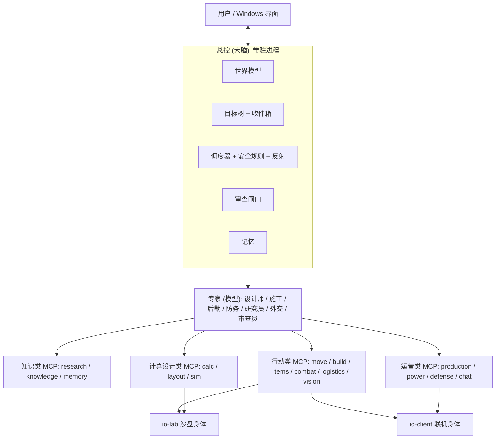

# 总体设计 (v2)

> 状态: 草案 v0.2 (2026-11-01: 加第 2b 节"决定归模型, 真相归工具", 改 3.3、3.4、10.4 和 io-client 的读内存; 用户同意)。第一版的教训见 [lessons-v1.md](lessons-v1.md), 路线图见 [roadmap.md](roadmap.md)。

## 1. 目标
1. AI 像资深玩家一样自主玩 Factorio 2.x + 太空时代, 单机和联机都能玩, 目标 95% 以上的时间无人值守。
2. 联机守规矩: 在别人的服务器上只能像玩家一样用键鼠操作, 不用控制台, 不改游戏数据。
3. 经验自己挣: 在本地沙盘里做实验、试设计。每条结论带出处和游戏版本号, 游戏更新后自动复查。
4. 用户是新手, 看不出设计对错, 所以每个设计都要由游戏引擎本身验证, 不能靠人把关。

## 2. 为什么不是"多接几个 MCP"就够
MCP 只是工具。第一版已经有上百个工具, 失败的原因不是工具少, 而是缺少下面四样东西:
- **一个总控 (大脑)**: 记住世界、排先后、分派任务、守规矩。
- **一个能验证的地方**: 设计先在引擎里跑通再用, 而不是被自己写的检查器"检查通过"。
- **一个会长大的经验库**: 机制和设计靠实验积累, 带版本号, 不靠模型的记忆。
- **一套记忆**: 让模型每次只拿需要的上下文, 不被长对话拖垮。

## 2b. 决定归模型, 真相归工具
来源: 交流群里玩家的经验 ("MCP 的操作应该把球给 AI; 带逻辑的 tool 效果很差; 给 agent 做 harness 搞了很多工程化的东西, 结果效果很差, 最后返璞归真; 尽可能减少提示词污染") 和 factorio-mcp 的透明适配器做法, 加上我们 2026-11-01 一天的实测。

工具分两种, 待遇不同:
| | 告诉模型真相 (要, 越准越好) | 替模型做决定 (不默认给) |
|---|---|---|
| 例子 | 读状态; 精确落格 (挨着这台机器东边的是哪几格、这根杆子盖不盖得到、两根杆子连不连得上); 执行模型定下的动作并读回核对; 静态检查器; 沙盘试跑和测量 | 一键建冶炼阵列; 自动补电线杆; 生成整块布局; 写死的开局流程 |
| 为什么 | 机械计算只有一个对的答案, 模型手算反而出错: 2026-11-01 十几次摆错全是模型手写坐标, 止住它的是引擎读数、静态检查器、回归测试 | 打法写进工具后, 模型变强它就成了天花板; 出错时分不清是工具的逻辑错还是模型的判断错 (hc 的教训; 第一版的开局引擎就是这类) |
| 怎么用 | 默认就有, 每个改变世界的工具做完都用引擎核对, 不对就报错, 不许静默 | 只作可选的"候选方案", 模型可以拿来改, 也可以不用; 不放进默认路径 |

核心循环: **模型做设计和取舍 → 检查器和沙盘给真相 → 模型自己改**, 直到沙盘过关。工具不夹带打法, 核对没有立场。

提示词也一样: 游戏里大脑和专家的系统提示保持短, 只放身份、目标、安全规则; 知识 (事实库、思路库、手册) 按需检索, 不默认塞进上下文。开发用的 CLAUDE.md 是给开发助手的, 不是给游戏里大脑的, 两者分开。

哪种做法更好也按老规矩进沙盘比: 同一个评测任务, A = 薄工具 + 核对, B = 厚工具 (带逻辑), 比成功率、用时和 token。

## 3. 结构

### 3.1 总控 (大脑)
常驻进程, 以代码为主, 只在需要判断时调用模型。
| 部件 | 做什么 |
|---|---|
| 世界模型 | 持续从游戏同步实体、物流网、电网、产量统计、敌人, 存进 SQLite; 任何专家都从这里查, 不靠对话记。 |
| 目标树 | 每个任务写清: 目标、前置条件、可测的完成标准、负责专家、预算。新需求先进收件箱, 判断属于哪个阶段, 不在关键路径的冻结并告知用户。 |
| 调度器 | 一个身体同一时间只做一件事。抢占顺序: 生存 > 电 > 补给 > 建设 > 扩张。玄冥星上"热"算进"电"那一档 (断热就断水、断电; 检索 aquilo.md A12 A13, 2026-10-31 第二轮检索补)。 |
| 反射 | 战斗、躲避、补燃料、黑启动, 毫秒级, 纯代码。 |
| 审查闸门 | 设计必须沙盘通过; 计划里的数字必须引用知识库; 拆别人东西、改共享设置这类动作必须先问人。 |
| 记忆 | 知识库 (事实 + 出处 + 版本 + 测试)、模式库 (沙盘验证过的设计)、经历 (做了什么、结果、复盘)。 |

### 3.2 专家 (模型)
每个专家每次只带当前任务需要的上下文: 任务、相关事实、世界模型摘要。
| 专家 | 职责 |
|---|---|
| 设计师 | 目标 → 产量 → 台数 → 布局; 只能用模式库和计算器, 结果交沙盘试跑。 |
| 施工 | 把验证过的设计变成动作序列, 开建前先备齐料 (第一版句芒计划里的思路, 2026-10-31 审查改), 监督执行, 逐件核对。 |
| 后勤 | 盯产量统计, 找瓶颈, 提修改方案。 |
| 防务 | 判断威胁 (孢子/污染、虫巢扩张), 设计和维护防线。 |
| 研究员 | 检索全网最新资料, 整理成待核实的说法; 在沙盘里做实验核实; 游戏更新后复查。 |
| 外交 | 联机聊天、汇报、按队友规则处理请求。 |
| 审查员 | 执行前按清单和以往教训审设计和计划。群里老玩家没空时, 由它补上"老手看一眼"这一步。 |

### 3.3 服务: 按领域分模块 (群友的方案; 2026-10-31 审查改)
模型做决定 ("去 X""这台冶炼块放在这里、朝东出料""打掉那个巢"), 对应领域的 MCP 负责机械计算 (寻路、碰撞、精确落格、覆盖和连线)、执行和核对; 方案和取舍不由 MCP 替模型做 (见第 2b 节; 2026-11-01 改)。每个专家只连接自己领域的几个 MCP, 工具列表短, 不会挑错。下表是按领域分的模块: 一个能力只有一个负责者, 每个专家只拿本领域工具; 每个模块是不是单独一个 MCP 进程, 按需要定 (2026-10-31 审查改)。
| 类 | MCP | 管什么 | 工具举例 | 主要使用者 | 阶段 |
|---|---|---|---|---|---|
| 身体 | io-lab | 沙盘: RCON 执行 Lua、读写任意、控制时间、存档回档、多开 | run_lua, snapshot, speed | 研究员、sim | M1 |
| 身体 | io-client | 联机: 读 (批量、增量、高层统计)、变化通知、键鼠和界面动作、截图、聊天; 我们自己重新做 (factorio-mcp 只作参考), 设计见 [io-client.md](io-client.md) | query, subscribe, act | 行动类、运营类 MCP | M4 |
| 知识 | research | 全网检索、抓取、资料库 (说法 + 出处 + 日期 + 版本 + 核实状态) | search, fetch, claims | 研究员 | M2 |
| 知识 | knowledge | 原型数据、配方、科技树、API 目录、更新日志、已核实的事实 | recipe, entity, fact, changes | 所有专家 | M2 |
| 知识 | memory | 世界模型查询、经历、复盘、教训 | world_state, episodes, lessons | 总控、所有专家 | M2 |
| 计算设计 | calc | 产量比例、台数 (含插件、插件效果分享塔、品质)、电、燃料、传送带和机械臂速度、机器人、火车运力、腐坏时间 | ratio, power, throughput | 设计师、后勤 | M3 |
| 计算设计 | layout | 检查 (重叠/接口/供电/传送带/流体/铁轨/物流网拓扑, 已有 `bp check`)、精确落格的几何工具 (挨着哪格、盖不盖得到、连不连得上)、蓝图编解码; 模式库和生成器只给候选, 设计师自己选和改 (2026-11-01 改) | check, slots, blueprint, candidates | 设计师 | M3 |
| 计算设计 | sim | 把设计放进沙盘试跑; 实验框架; 评测场 | trial, experiment, benchmark | 设计师、研究员 | M3 |
| 行动 | move | 寻路 (碰撞图层、地形、危险区)、走路、开车/坦克/蜘蛛机甲 | go_to, drive_to | 施工、防务 | M5 |
| 行动 | build | 放蓝图和幽灵、拆除、填海、逐件核对、修理 | place, deconstruct, verify | 施工 | M5 |
| 行动 | items | 物品栏、按数量取放、手搓队列、装备栏、装弹加燃料 | take, put, craft, equip | 施工、防务 | M5 |
| 行动 | combat | 威胁评估、换枪、风筝、撤退、炮塔推进、清巢; 反射循环在里面跑 | engage, retreat, clear_nest | 防务 | M5 |
| 行动 | logistics | 请求、箱子设置、配方、电路条件、火车时刻表和车站 | set_request, set_recipe, schedule | 施工、后勤 | M5 |
| 行动 | vision | 截图和画面核对, 只在结构化读取看不到时用 | screenshot, compare | 所有 | M5 |
| 运营 | production | 产量统计、机器状态普查、瓶颈和断料诊断 | stats, census, diagnose | 后勤 | M6 |
| 运营 | power | 电网统计、燃料供应、蓄电器、黑启动 | grid, fuel, blackstart | 后勤 | M6 |
| 运营 | defense | 孢子和污染地图、虫巢和扩张、防线覆盖、弹药供应、重炮 | threat_map, coverage | 防务 | M6 |
| 运营 | chat | 队友沟通: 读写、点名回复、汇报模板、队友任务排队 | read, say, report | 外交 | M6 |
| 以后 | space | 太空平台设计、星际物流 | | | M8 |

### 3.4 每个 MCP 都要达到的标准
1. **注入提示要短**: 连接时只注入接口用法和本领域最常见的几个错误 (instructions); 规则、例子和资料放 prompts / resources, 模型要用时自己取, 不默认塞进上下文 (第 2b 节, 减少提示词污染; 2026-11-01 改)。这些内容是仓库里的文件, 跟着游戏版本更新。
2. **工具少, 不夹带打法**: 机械计算 (坐标、碰撞、覆盖、连线、寻路) 归工具, 不让模型手算坐标、点界面; 方案和取舍归模型, 工具不替它定 (第 2b 节; 2026-11-01 改)。
3. **结果带核对状态和证据**: 读回的数据、截图或沙盘测量; 核对不了就明说, 不报"成功"。模型会相信自己的工具, 所以工具必须诚实。
4. **一个能力只有一个负责的 MCP**: 技能注册表 + 自动检查重复; 新技能走"提出 → 实现 → 沙盘测试 → 登记", 不自动生成没测过的技能。
5. **回归测试**: 每个 MCP 都有在沙盘里跑的测试; 游戏更新后全部重跑。
6. **输出有上限, 默认就小** (2026-11-01, 见 [lessons-others.md](lessons-others.md)): 图片默认最长边 ≤800、≤300KB (像素游戏够用), 大图要显式参数和理由; 文本分页; 大数据先压缩, 超上限拒绝并提示分页; 每次调用记字节数和 token, 每个任务有预算。
7. **优先用成熟库**: 图片 sharp / pngjs, 压缩 zlib, 数据库 node:sqlite, MCP 官方 SDK; 自己写只限于没有库的部分, 且要有对照测试。
8. **做完就核对, 失败不许静默** (2026-11-01): 每个改变世界的工具 (摆放、连线、设置) 做完都向引擎读回结果并核对, 不对就报错带原因; 自动修正 (补杆、重试) 只是兜底, 触发了就记下来当失败查原因。来历: 沙盘的供电函数把四角放到超过连线距离, 连线失败不报错, 自动补杆把它盖住了好几轮, 用户在窗口里看出来的 ([lab.md](lab.md) #31)。

### 3.5 两个身体
- **沙盘身体**: 本机另开的无界面服务器 + RCON, 等于上帝模式, 可以多开并行跑实验。只用于学习和验证, 从不连别人的服务器。
- **联机身体**: 游戏客户端 + io-client (我们自己重新做; 做好之前真要联机, 临时用 factorio-mcp), 只能像玩家一样操作。
- 为了在上线前测试联机身体, 可以让本机客户端连进沙盘服务器, 用同样的键鼠方式操作; RCON 只用来对照结果和重置场景。
- 单机和本机沙盘都把隐藏设置 `technology-gui-pauses-game` 关掉: 单机时科技窗口和 ESC 菜单会暂停游戏, 实体窗口不会 (实体窗口这半句待带界面的客户端核实) (2026-10-31 审查改)。

## 4. 经验从哪来 (学习循环)
**主要靠全网最新资料, 沙盘负责核实。** 只靠沙盘自己摸索远远不够: 老玩家几千小时的经验、官方的设计意图、每个版本的改动, 都在网上。
1. **全网检索 (主要来源)**: 研究员定期检索并整理成"待核实说法", 每条记下出处、日期、对应的游戏版本。来源按可信度排:
   | 等级 | 来源 | 用途 |
   |---|---|---|
   | 1 | 本机游戏自带: 原型数据导出、`doc-html` 里的 API 文件、`data/changelog.txt` 更新日志、游戏内提示 | 数值、接口、每个版本改了什么 (最新、最准) |
   | 2 | 官方: wiki.factorio.com、开发周报 FFF、官方论坛的公告和 bug 贴 | 机制解释、设计意图 |
   | 3 | 老玩家社区: 论坛攻略、Reddit r/factorio、B 站/贴吧/NGA 的中文攻略、计算器 (FactorioLab 等)、蓝图站 | 布局套路、比例、打法、常见坑 |
   | 4 | 视频攻略 (按字幕整理) | 思路参考 |
   - 新鲜度: 说法的日期早于它涉及内容的最近一次版本改动, 就标"可能过时", 优先核实。
2. **沙盘核实**: 影响设计的说法, 在沙盘里做实验确认, 确认后才变成知识库里的"事实" (带出处 + 版本 + 实验编号 + 回归测试)。核实不了的标"未核实", 设计时不能当依据。
3. **机制课程**: 按主题系统地过一遍 (物流网、火车、流体、电、腐坏、生物室、农业、敌人、品质、太空平台), 每个主题先检索、再实验。
3b. **思路库**: 老玩家在什么情况下怎么选、为什么、代价、牵连、流派, 按情况索引 (`knowledge/patterns/`, 格式见那里的 README)。来源: 老玩家本人 (朋友的基地反推 + 问他本人) > 开发周报的设计意图 > 老玩家长文和分歧帖 > 从说法表提炼。设计师先查思路库再算数; 审查员按它挑毛病; 一条思路要靠下面的设计搜索并排比过才算核实。
4. **设计搜索**: 社区布局和自己生成的方案一起进沙盘并行跑, 按产量、占地、用电、稳健性打分, 最好的进模式库 (社区成熟设计注明出处、版本、许可, 和自己生成的方案同样参与比较; 进库的要参数化并经沙盘验证; 公开仓库不放别人蓝图原文; 2026-10-31 审查改)。
5. **版本复查**: 游戏更新后读新的更新日志, 对比新旧原型数据, 标出变了的配方和建筑, 重新检索相关资料, 重跑相关实验和模式。
6. **复盘**: 每次死亡、停电、断料、设计错误 → 找原因 → 写成规则和测试, 同样的错不犯第二次。

2026-10-31 的例子: 第一版车站的错, wiki 一句话就说清楚了 (机器人取货先找主动供货箱, 不看远近); 2.1 修好了句芒五足虫的扩张、改了异虫卵的解锁科技、电路改成红绿线分开输入, 这些只在更新日志里有。注意更新日志的"模组"分节只是给模组开接口, 不等于原版改了 (例: 农业塔的插件接口, 原版农业塔仍然没有插件槽, 本机原型数据核实)。

## 5. 上下文怎么管
- 模型不需要"记住"游戏: 每次调用都从知识库和世界模型取需要的部分。
- 总控是常驻进程, 不会因为对话变长而丢东西。
- 开发时的 Claude Code 会话到 80% 自动生成交接提示词, 换新会话继续。

## 6. 规矩
- 联机: 读取不是随便都安全, 客户端里的 Lua 读取接口要先过沙盘的存档和 CRC 检查 (见 10.4; 2026-10-31 审查改), 动作只用键鼠; 不拆不改别人的建筑和设置, 共享材料每样不超过库存一半 (2026-10-31 审查改); 队友规则照旧 (回复点名、动手前说、做完汇报、材料先自给)。
- 沙盘: 控制台和 RCON 随便用, 但只在本机, 不连别人的服务器。
- 公开仓库里不放游戏本体文件、导出的游戏数据、别人的蓝图和任何账号信息, 这些都由脚本在本机生成。

## 7. 技术选型
- TypeScript, Node 24 直接运行; MCP 官方 SDK; Claude Agent SDK; SQLite (Node 自带)。
- 界面: Windows 桌面程序, Tauri, 照 x.ai/bot 三栏聊天布局, 全中文, 作为总控的客户端; 先做 run.ts 的本机控制接口, 再做界面。
- 第一版代码只作参考: 战斗数值、对接检查、寻路碰撞、地形扫描这些经过测试的部分, 按新结构重写后再移植。

## 8. 补上的部分 (2026-10-31 查缺补漏)
| 缺口 | 做法 |
|---|---|
| 怎么"训练" | 不训练模型本身。在沙盘里准备一组有分数的任务 (评测场): 例如从空地 30 分钟做到每分钟 45 个绿瓶、句芒生物核心从零自举、守住一波五足虫。每次改知识、提示或工具后跑一遍, 分数只许升不许降。另设一档加速长跑 (游戏内 10 小时以上): 溢出、流体波动、侧向汇入不均要跑很久才暴露 (检索 production.md P8, 2026-10-31 第二轮检索补); 判分不能只看游戏自带的 production-score, 它不计只产不耗的物品 (沙盘实测, 见 [lab.md](lab.md)) |
| 省 token 但不变笨 | 总控以代码为主; 例行事务用便宜模型, 设计和审查用强模型; 每次专家调用有预算; 统计每个任务花的 token |
| 监控和人工接管 | 界面置顶显示威胁警报、死亡次数、预判卡片、当前任务; 用户在玩时自动让出控制, 只读不动; 一键暂停 |
| 崩溃恢复 | 看门狗盯游戏进程和连接: 自动存档前后不读不动 (第一版遇到过存档时崩溃, 原因是注入客户端的 Lua 读取, 不是存档本身; 只有 io-client 需要这条保护, 并要在沙盘里测存档; io-lab 用正式模组 + RCON, 不需要) (2026-10-31 审查改), 掉线重连, 单机读最新存档, 后台自己重启 |
| 多世界 | 每个存档或服务器一套世界模型和计划; 进别人的服务器自动进协助模式 |
| 单机 | 和联机用同一个身体 (io-client), 读写同一套世界模型 |
| 太空和品质 | 太空平台 M8 再做; 计算器从一开始就支持品质 |
| 用户以前定下的要求 | 逐条列在 [requirements.md](requirements.md), 每条对应到组件和阶段, 重做时不漏 |

## 9. 从 FLE 学到的 (2026-10-31, 详见 [research/fle.md](research/fle.md))
| 学什么 | 落到哪里 |
|---|---|
| 评测场: 吞吐任务 + 判分前放手 60 秒 + 只计自动化产出 + 同一任务跑多次统计; 错误分 语法 / 接口用法 / 状态认知 / 规划 四类 | sim 的评测场 (M2 雏形, M6 全部达标) |
| io-lab 做成正式模组, 不在运行时注入脚本 (FLE 因此不能存档、客户端一加入就崩); storage 只放数据, 对外用 remote 接口, 事件统一分发; RCON 大响应先压缩; 连接存活检测, "没读到"不能当"读到空" | io-lab (M1) |
| 每个工具配手册: 用法 + 常见失败 + 带修复提示的报错 + 实体状态枚举 | 所有 MCP 的注入提示 (3.4 节) |
| 模型最常见的错是对游戏状态认知错: 专家每次都从世界模型重读; 工具返回动作后的真实状态; 记忆用固定状态面板 + 三段式报告 (建筑和坐标、归类后的错误、可复用的方法) | 总控、memory |
| 机制写成引擎内测试, 注释引用 API 文档; FLE 的 2.0 迁移清单和社区经验作为第一批待核实说法 | knowledge、实验框架 (M2) |

## 10. 运行起来是什么样: 怎么调用, 怎么全自动
### 10.1 谁调用 MCP
- 每个领域模块对外是一个 MCP; 几个模块放一个进程还是分开, 按需要定 (2026-10-31 审查改)。总控连接全部 MCP, 是"总接线台"。
- **专家调用**: 总控按任务临时启动一个专家 (Claude Agent SDK, 无界面运行), 只接上这个领域的几个 MCP。例: 施工专家只接 build、move、items、logistics、knowledge、memory, 看不到别的工具, 不会挑错。
- **代码直接调用**: 反射和监控不经过模型, 直接调 MCP。例: 战斗反射每秒调 combat, 电力监控每分钟调 power。
- **MCP 之间分层调用**: 行动类和运营类 MCP 通过同一套"身体接口"调 io-client 或 io-lab, 所以同一个 build 在沙盘和联机上都能用; calc 向 knowledge 查配方。

### 10.2 一个目标从头到尾
例: "做一条每秒 3 块铜板的线"
1. 目标进收件箱, 总控判断属于哪个阶段, 拆成任务: 设计 → 审查 → 施工 → 验收。
2. 设计师: knowledge 查配方 → calc 算台数和电 → layout 出布局 → sim 在沙盘里跑 30 分钟, 实测达标才交出 (要长期运行的关键设计再加速长跑)。
3. 审查员: 对照知识库和以往教训检查 (例: 车站两头是不是同一张物流网), 不过就退回。
4. 施工: move 走过去 → items 备料 → build 放蓝图并逐件核对 → logistics 设请求和配方。
5. 验收: production 连续 10 分钟读产量, 达标才算完成; 结果和教训写进 memory。

### 10.3 全自动靠四个循环
| 节奏 | 谁做 | 做什么 |
|---|---|---|
| 每秒 | 反射, 纯代码 | 战斗、躲避、危险区、补燃料 |
| 每分钟 | 监控, 纯代码 | 同步世界模型; 查电、产量、防御、弹药; 发现问题自动生成任务 |
| 每个任务 | 调度器 + 专家 | 按"生存 > 电 > 补给 > 建设 > 扩张"挑最该做的任务, 调专家执行, 核对结果 |
| 每天 | 研究员 | 查新版本和全网资料、做沙盘实验、跑评测场、更新模式库 |
- **任务从哪来**: 用户的长期目标、监控自动生成的维护任务、队友的请求。
- **停了能接着干**: 任务和世界模型存在数据库里; 看门狗发现游戏崩溃或掉线就重启重连, 总控从数据库恢复。
- **什么时候找人**: 只有规则外的决定 (拆别人的东西、大量用共享资源)、同一任务失败 3 次、设计在沙盘里过不了, 才在界面和聊天里问用户。
- **用户想玩时**: 检测到用户在操作就让出控制, 只读不动; 界面一键暂停。
- **省 token**: 四个循环里只有"每个任务"和"每天"用到模型, 其余都是代码。

### 10.4 无头模式和内存注入的分工 (2026-10-31; 读内存一行 2026-11-01 改)
| | 沙盘 (自己的服务器) | 联机 (别人的服务器) |
|---|---|---|
| 怎么接 | 无头模式 + 我们的模组 + RCON / UDP | 内存注入游戏客户端 (io-client) |
| 能做 | 完整模拟、读写一切、加速、多开、存档回档; 不用显卡 | 读客户端里同步的整个世界、读界面、像玩家一样输入 |
| 做不了 | 没有画面和界面, 不能测键鼠操作 | 不能改游戏状态 (会和服务器不同步被踢), 版本更新后要重新定位 |
| 补法 | 本机客户端连进沙盘, 用 io-client 测键鼠操作 | 读取两条路并用, 按"测出来哪条更稳更快"给每类数据定主路: **读内存** 不在游戏线程里跑代码, 不会因为读取弄崩存档或造成不同步, 兼容任何模组, 适合大批量、高频的读 (**更正 2026-11-02**: 原来写成"factorio-mcp 的设计的长处", 通读他的代码后发现他**没有进程外读世界内存**, 世界状态全在游戏主线程的安全点里跑 Lua 读, 这一路要我们从零做; 另一个选项是像他一样在安全点上进程内读, 数据一致, 见 io-client.md 第 9 节); **只读 Lua** 跟着 API 文件走、不怕更新, 适合高层统计和读内存难定位的数据, 每个接口先在本机联机沙盘跑"存档 + 全量 CRC"检查, 过了才开放。读内存的规矩: 只读不写; 按官方调试符号定位, 游戏更新后自动重新定位并用沙盘真值核对; 定位失败或核对不过就停用那一类读取 (退回 Lua 或键鼠), 不带着错地址读 |

## 11. 自我升级、自动迭代 (2026-10-31)
模型本身的参数改不了; 能自己升级的是系统里的其他一切, 按风险分四层, 每层都要过闸门:
| 层 | 例子 | 谁来改 | 闸门 |
|---|---|---|---|
| 知识 | 新核实的事实、版本变化、教训 | 研究员自动写入 | 有出处 + 沙盘实验通过 |
| 模式和提示 | 模式库里的设计、各 MCP 的手册和注入提示 | 研究员、审查员 | 评测场分数不降 |
| 工具和技能 | MCP 里的工具实现、新技能 | 开发专家 (无界面运行的 Claude Code) 在分支上改 | 单元测试 + 沙盘回归 + 评测场全部不降; 新技能先登记再用 |
| 总控和规矩 | 调度、安全规则、权限 | 只提建议 | 必须用户同意 |

**升级循环** (每次失败、每次游戏更新、每天定时都会触发):
1. 发现问题: 死亡、停机、断料、评测分数下降、游戏更新、新的全网资料。
2. 复盘: 找原因, 归到上面四层里的一层。
3. 提出改动: 在独立分支上改知识、提示或代码。
4. 自动验证: 单元测试、沙盘回归测试、评测场。
5. 合并: 前两层验证通过就自动合并; 第三层通过后自动开 GitHub 合并请求, 低风险的自动合并, 其余等用户看; 第四层只提建议。
6. 上线和观察: 重启对应的 MCP, 盯指标; 变差就自动回滚到上一版。
- 每次升级在更新日志里写一条: 改了什么、为什么、分数变化, 用户随时能看。
- 安全规则和权限永远不自动改; 每天的升级次数和 token 有上限。
